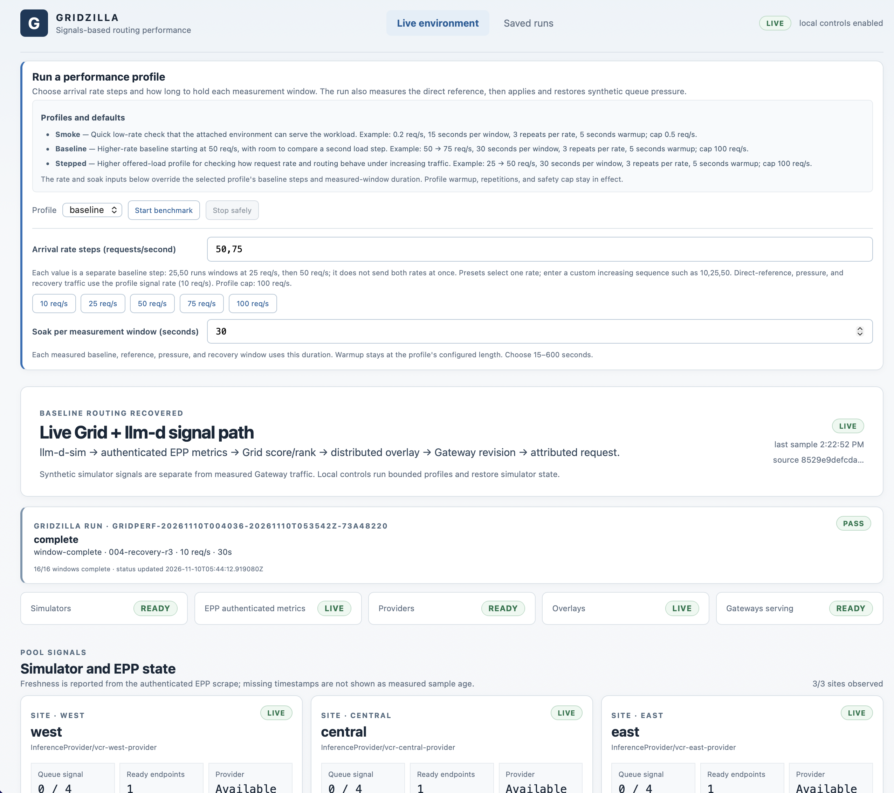

# Gridzilla

Gridzilla is a local benchmark product with two scenarios that share one k6
traffic engine and one saved-report format:

1. **Generic HTTP endpoint** sends bounded JSON POST traffic to a
   server-configured endpoint. It does not need Grid, Kubernetes, a setup
   handoff, a simulator, or a backend reference.
2. **Grid / llm-d signals** attaches to the persistent combined-site
   environment described by Grid's handoff. It retains run ownership checks,
   authenticated EPP and Gateway readiness, routing attribution, synthetic
   simulator pressure, recovery, and the dedicated llm-d signals report view.



k6 generates bounded traffic. In the Grid scenario, llm-d-sim supplies a
synthetic queue-pressure signal, EPP exposes authenticated scheduling metrics,
Grid ranks providers and distributes an overlay, and the Gateway consumes that
overlay. Gridzilla coordinates gates, captures evidence, and serves the UI and
local JSON API. Prometheus and Perses provide optional local metric dashboards.

Neither scenario proves GPU capacity, model quality, or real token throughput.
Generic runs measure observed HTTP behavior for the selected endpoint and
workload. Grid runs measure routing and control-path behavior under synthetic
pressure. k6 results are not numerically comparable to historical Vegeta
results just because request sizes match.

## Generic endpoint: first run

Install Python 3.11+, Node.js/npm for the UI, and the pinned k6 v1.8.2 binary
for traffic. The JSON endpoint definition is trusted server-side test data; it
may refer to an optional credential file and CA file. Do not put secrets in the
JSON template.

```sh
python3 -m venv .venv
. .venv/bin/activate
python -m pip install -e .
tools/install-k6.sh
gridzilla endpoint list --config-dir examples/endpoints
gridzilla endpoint preflight --config-dir examples/endpoints \
  --id example-openai-chat --profile profiles/body-sizes.json
gridzilla run --endpoint-config examples/endpoints/openai-chat.json \
  --profile profiles/body-sizes.json --evidence-root evidence
```

The shipped `body-sizes` profile measures 16, 64, and 256 KiB serialized JSON
bodies in three windows per size. It pads only a configured string field, keeps
the small template in configuration, and checks exact UTF-8 body bytes in k6.
An OpenAI chat-completions request is one example; ordinary generic JSON does
not need OpenAI fields.

## Grid / llm-d signals: attach to an existing environment

Start the persistent environment from Grid's combined-site xtask. Gridzilla
does not create or delete clusters:

```sh
cargo xtask env start-grid-combined-site-signals \
  --run-id grid-signals-<unique-suffix>
gridzilla doctor --handoff /path/to/handoff.json
gridzilla smoke --handoff /path/to/handoff.json
gridzilla run --handoff /path/to/handoff.json --profile profiles/baseline.json
```

The handoff and adjacent run manifest establish cluster ownership, kubeconfig
paths, endpoint identities, credentials-file paths, source revisions, and
immutable image identities. Gridzilla fails closed if those gates do not
match. Temporary pressure changes only the marked llm-d-sim signal and is
restored and verified before completion.

See [the usage guide](docs/usage.md) for prerequisites, reports, API examples,
profiles, safety bounds, and explicit cleanup instructions for the setup
owner's clusters.

## Local dashboard and agent API

The UI is read-only by default. Start either scenario with `--allow-controls`
to enable bounded dashboard controls. Generic endpoints are loaded from a
server-owned directory; the browser and API can select a configuration ID but
cannot submit arbitrary URLs, credentials, profile paths, or commands. A
separate bearer token can authorize a local agent without imitating a browser
Origin:

```sh
umask 077
agent_token_file="${XDG_STATE_HOME:-$HOME/.local/state}/gridzilla/agent-token"
mkdir -p "$(dirname "$agent_token_file")"
openssl rand -hex 32 > "$agent_token_file"
chmod 600 "$agent_token_file"
gridzilla serve --runs-dir evidence --host 127.0.0.1 --port 8765 \
  --allow-controls --endpoints-dir examples/endpoints \
  --agent-token-file "$agent_token_file"
```

The dashboard binds only to loopback. Browser controls retain same-origin
protection; agent requests omit `Origin` and use the local token. The API uses
the same validators, profile planner, controls, k6 runner, and saved evidence
as the UI and CLI. It does not create a second traffic engine.

## Architecture and development

```text
src/gridzilla/       Grid and generic scenario orchestration, planning, API
k6/gridzilla.js      Shared bounded traffic engine
profiles/            Validated workload profiles, including body-sizes
examples/endpoints/  Server-loaded generic endpoint definitions
frontend/            Existing dashboard and saved-report views
observability/       Local Prometheus and Perses configuration
```

```sh
PYTHONPATH=src python3 -m unittest discover -s tests -v
K6_BIN="$PWD/.tools/k6-v1.8.2/k6" PYTHONPATH=src \
  python3 -m unittest discover -s tests -v
npm ci
npm run build
npm run test:ui
git diff --check
```

The screenshot above illustrates the UI and is not evidence of a benchmark
result. Additional report and Perses screenshots use controlled sample data
and are labeled illustrative. The repository currently has no tracked
`LICENSE`; maintainers should choose one before broader redistribution.
